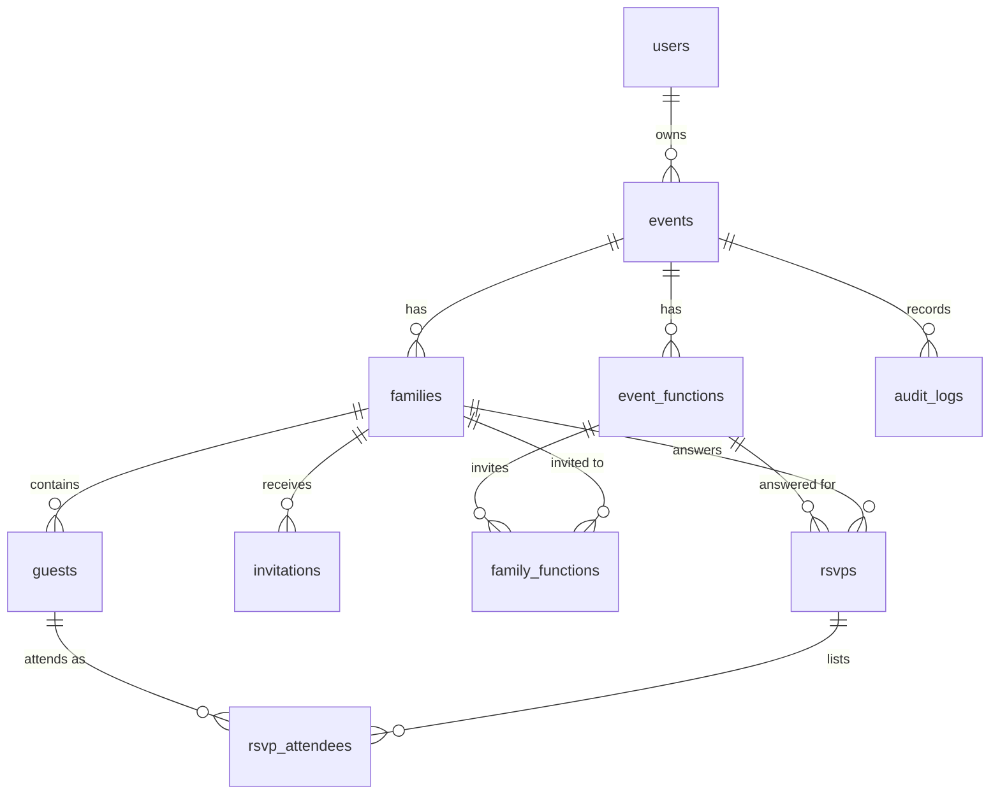

# Mehfil: Database Schema

> **Status:** Phase 0 (planning). This is the intended schema. It is finalized when the models and migrations are written in Phase 3, and any difference between this document and the migrations is corrected here.

## 1. Conventions

- **Primary keys:** integer `id`, auto-incremented, unless stated otherwise.
- **Timestamps:** stored in UTC. Each event has a `timezone` used only for display.
- **Enumerated values** (status, role, and so on) are stored as short text with a `CHECK` constraint, which works identically on SQLite and PostgreSQL.
- **Foreign keys** are enforced on both databases. SQLite needs `PRAGMA foreign_keys=ON`, which the app sets on every connection.
- **Derived values are never stored.** Attendee counts, pending status, and meal totals are computed from rows (see section 5).

## 2. Entity relationships

(GitHub renders this diagram. `docs/APP_FLOW.svg` shows the workflows that use these tables.)

## 3. Tables

### 3.1 `users`
| Column | Type | Constraints |
|---|---|---|
| `id` | integer | PK |
| `email` | text | NOT NULL, UNIQUE (stored lowercase) |
| `password_hash` | text | NOT NULL |
| `name` | text | NOT NULL |
| `role` | text | NOT NULL, default `host`, CHECK in (`host`, `admin`) |
| `is_active` | boolean | NOT NULL, default true |
| `created_at` | timestamp | NOT NULL |
| `last_login_at` | timestamp | NULL |

### 3.2 `events`
| Column | Type | Constraints |
|---|---|---|
| `id` | integer | PK |
| `owner_id` | integer | NOT NULL, FK -> `users.id` |
| `title` | text | NOT NULL |
| `host_message` | text | NULL (shown on the invitation page) |
| `rsvp_deadline` | timestamp | NULL (no deadline if empty) |
| `catering_buffer_pct` | integer | NOT NULL, default 10, CHECK 0-100 |
| `timezone` | text | NOT NULL, default `Asia/Kolkata` |
| `created_at` | timestamp | NOT NULL |

### 3.3 `event_functions` (ceremonies)
| Column | Type | Constraints |
|---|---|---|
| `id` | integer | PK |
| `event_id` | integer | NOT NULL, FK -> `events.id` ON DELETE CASCADE |
| `name` | text | NOT NULL |
| `starts_at` | timestamp | NOT NULL |
| `venue_name` | text | NULL |
| `venue_address` | text | NULL |
| `map_url` | text | NULL |
| `dress_code` | text | NULL |
| `buffer_pct` | integer | NULL, CHECK 0-100 (overrides the event default when set) |
| `sort_order` | integer | NOT NULL, default 0 |

### 3.4 `families` (the invitation unit)
| Column | Type | Constraints |
|---|---|---|
| `id` | integer | PK |
| `event_id` | integer | NOT NULL, FK -> `events.id` ON DELETE CASCADE |
| `name` | text | NOT NULL (for example "Sharma family") |
| `contact_name` | text | NULL |
| `phone` | text | NULL (text, not integer, to keep `+91` and leading zeros) |
| `email` | text | NULL |
| `side` | text | NOT NULL, default `both`, CHECK in (`bride`, `groom`, `both`) |
| `invited_count` | integer | NOT NULL, CHECK >= 1 (seats reserved) |
| `notes` | text | NULL |

### 3.5 `family_functions` (which ceremonies a family is invited to)
| Column | Type | Constraints |
|---|---|---|
| `family_id` | integer | FK -> `families.id` ON DELETE CASCADE |
| `function_id` | integer | FK -> `event_functions.id` ON DELETE CASCADE |

Primary key: composite (`family_id`, `function_id`). A family and function pair can appear only once.

### 3.6 `guests` (individual people)
| Column | Type | Constraints |
|---|---|---|
| `id` | integer | PK |
| `family_id` | integer | NOT NULL, FK -> `families.id` ON DELETE CASCADE |
| `full_name` | text | NOT NULL |
| `age_group` | text | NOT NULL, default `adult`, CHECK in (`adult`, `child`, `infant`) |
| `food_pref` | text | NOT NULL, default `veg`, CHECK in (`veg`, `non_veg`) |
| `dietary_notes` | text | NULL (Jain, allergies, and so on) |
| `is_primary` | boolean | NOT NULL, default false (the contact person of the family) |

### 3.7 `invitations`
| Column | Type | Constraints |
|---|---|---|
| `id` | integer | PK |
| `family_id` | integer | NOT NULL, FK -> `families.id` ON DELETE CASCADE |
| `token` | text | NOT NULL, UNIQUE (22-character URL-safe random string) |
| `status` | text | NOT NULL, default `active`, CHECK in (`active`, `revoked`) |
| `created_at` | timestamp | NOT NULL |
| `revoked_at` | timestamp | NULL |
| `first_opened_at` | timestamp | NULL |
| `last_opened_at` | timestamp | NULL |
| `open_count` | integer | NOT NULL, default 0 |
| `last_shared_via` | text | NULL (for example `whatsapp`, `qr`, `copy`) |

A family can have several rows over time, because regenerating a link revokes the old row and creates a new one. **At most one `active` invitation per family** is enforced in the service layer in Phase 5.

### 3.8 `rsvps` (a family's answer for one function)
| Column | Type | Constraints |
|---|---|---|
| `id` | integer | PK |
| `family_id` | integer | NOT NULL, FK -> `families.id` ON DELETE CASCADE |
| `function_id` | integer | NOT NULL, FK -> `event_functions.id` ON DELETE CASCADE |
| `status` | text | NOT NULL, CHECK in (`accepted`, `declined`) |
| `expected_arrival` | timestamp | NULL |
| `notes` | text | NULL |
| `submitted_at` | timestamp | NOT NULL |
| `updated_at` | timestamp | NOT NULL |

Unique constraint: (`family_id`, `function_id`). This blocks duplicate RSVPs at the database level.

### 3.9 `rsvp_attendees` (who attends that function)
| Column | Type | Constraints |
|---|---|---|
| `rsvp_id` | integer | FK -> `rsvps.id` ON DELETE CASCADE |
| `guest_id` | integer | FK -> `guests.id` ON DELETE CASCADE |

Primary key: composite (`rsvp_id`, `guest_id`). A declined RSVP has no attendee rows.

### 3.10 `audit_logs` (append-only)
| Column | Type | Constraints |
|---|---|---|
| `id` | integer | PK |
| `event_id` | integer | NULL, FK -> `events.id` ON DELETE SET NULL |
| `actor_type` | text | NOT NULL, CHECK in (`user`, `guest`, `system`) |
| `actor_user_id` | integer | NULL, FK -> `users.id` ON DELETE SET NULL |
| `actor_family_id` | integer | NULL (plain integer, no FK, because the family may later be deleted) |
| `action` | text | NOT NULL (for example `guest.update`, `rsvp.submit`) |
| `entity_type` | text | NOT NULL |
| `entity_id` | integer | NULL (no FK, because it points to different tables) |
| `old_values` | JSON | NULL |
| `new_values` | JSON | NULL |
| `created_at` | timestamp | NOT NULL |

Logs deliberately avoid cascading deletes so history survives when records are removed. The application never updates or deletes rows in this table.

## 4. Indexes

| Index | Purpose |
|---|---|
| `users(email)` UNIQUE | Login lookup |
| `invitations(token)` UNIQUE | Every guest page load |
| `rsvps(family_id, function_id)` UNIQUE | Duplicate prevention, RSVP lookup |
| `families(event_id)` | Guest list |
| `families(event_id, name)` | Search and sorting |
| `guests(family_id)` | Loading a family's members |
| `event_functions(event_id, sort_order)` | Ceremony list |
| `rsvps(function_id, status)` | Dashboard and catering counts |
| `audit_logs(event_id, created_at)` | Recent activity feed |
| `audit_logs(entity_type, entity_id)` | History of one record |

Primary keys and unique constraints create their own indexes automatically. No other indexes are added, because each one slows writes, and we add more only when a real query needs it.

## 5. Derived values (never stored)

| Value | How it is computed |
|---|---|
| Attendees for a function | Count of `rsvp_attendees` rows for accepted RSVPs of that function |
| Pending families for a function | Families in `family_functions` for that function with **no** `rsvps` row (LEFT JOIN where the RSVP is NULL) |
| Veg / non-veg meals | Attendees grouped by `guests.food_pref` |
| Weighted meals | Attendees grouped by `age_group` and `food_pref`, weighted, then buffered (Phase 6) |
| Buffer used | `event_functions.buffer_pct` if set, otherwise `events.catering_buffer_pct` |

## 6. Integrity rules the database cannot express alone

These are enforced in the service layer and covered by tests:

1. An RSVP's attendees must belong to the same family as the RSVP.
2. A family can RSVP only to functions listed in `family_functions`.
3. The number of attendees must not exceed `families.invited_count`.
4. RSVPs cannot be created or changed after `events.rsvp_deadline`.
5. Every query on events, families, and guests is scoped to the signed-in host (`events.owner_id`).

## 7. Cascade summary

| Deleting... | Also removes |
|---|---|
| An event | Its functions, families, guests, invitations, RSVPs, and attendees. `audit_logs.event_id` becomes NULL, and the logs stay. |
| A family | Its guests, invitations, RSVPs, and attendee rows |
| A function | Its RSVPs, attendee rows, and `family_functions` rows |
| A user | Not allowed while they own events (no cascade on `events.owner_id`). Hosts deactivate accounts with `is_active` instead. |